# Action Tags {#sec-designint-action}

<!--comment-->
<!--two # = 2nd level heading-->

**Chapter Leads**: Lise DeShea & Thomas Wilson

## Purpose {#sec-designint-action-purpose}

Action tags are used in REDCap to modify the appearance or behavior of items in a project.
They are added to the *Action Tags/Field Annotation* box under the Field Label in the Edit Field window for each variable.

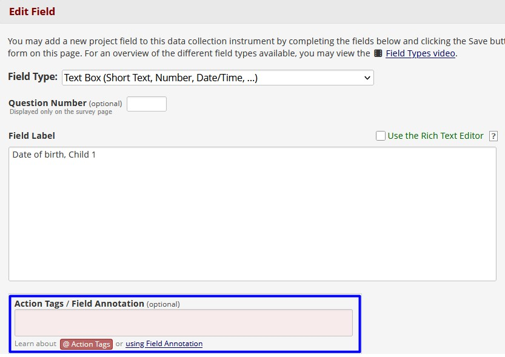{width=80%}

## Common {#sec-designint-action-common}

We will explain some of the more common action tags, then we will cover a few of the less common ones. We will start with a simple example.

### `@HIDEBUTTON` {#sec-designint-action-common-hide}

> Hides the 'Now' or 'Today' button that is typically displayed to the right of date, time, and date/time fields.
> (Official definition from REDCap 17.6.2.)

By default, date fields appear with a button labeled Today.
Clicking that button fills in today's date.
Sometimes a project designer does not want that button available.
A designer might want to force people reviewing past years' medical records to enter that date's year.
Every action tag begins with an at-sign, @.
The action tag to hide the Today button is `@HIDEBUTTON`.
When you click inside the Action Tags/Field Annotation box, it then opens another window, called the *Logic Editor.*

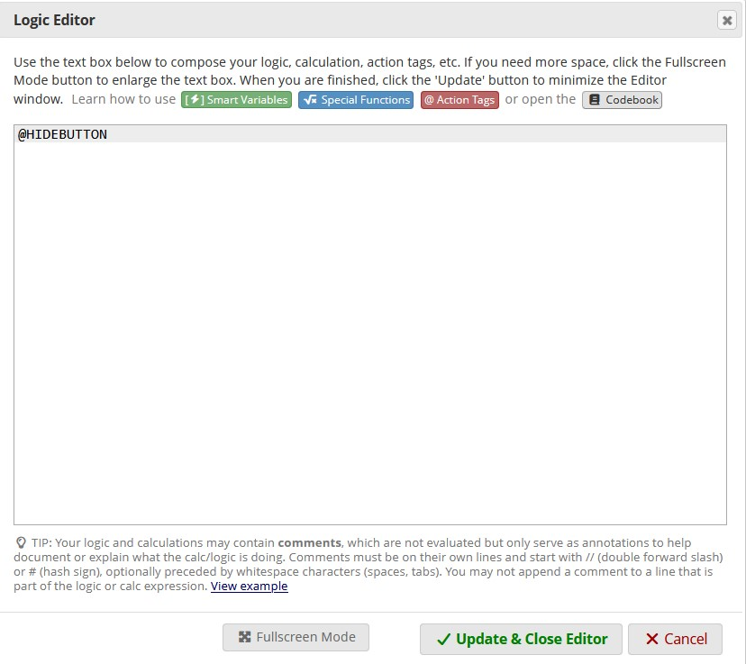{width=80%}

You can see that we have typed `@HIDEBUTTON` in the Logic Editor.
What if you cannot remember if this action tag has a hyphen in the middle?
You can click the red "@ Action Tags" button at the top of the Logic Editor and see a list of action tags and explanations.
To save this action tag, you click *Update & Close Editor*, then click the *Save* button on the Edit Field window.
Now the Today button no longer appears next to the date field.

### `@DEFAULT` {#sec-designint-action-common-default}

> Sets a field's initial value. This allows a field to have a specified default value when viewing the field on a survey or data entry form that has not yet had any data saved for it (i.e., when the form status icon is gray or when a survey page has not had any data entered yet). The format must follow the pattern `@DEFAULT="????"`, in which the desired default value should be inside single or double quotes. For checkbox fields, simply separate multiple checkbox values with commas - e.g., `@DEFAULT='1,3,6'`.
> For text fields, you may even perform Piping inside the default value to pipe data from another field in the project - e.g., `@DEFAULT='Name: [first_name] [last_name], DOB: [dob]'`.
>
> * NOTE: The default value does *not* get applied during any data imports (via API or Data Import Tool) but only operates when viewing survey pages and data entry forms.
> * NOTE: If being used on a date or datetime field, the date value inside the quotes must be in Y-M-D format - e.g., `@DEFAULT='2007-12-25'` - regardless of the field's set date format. TIP: To pipe the value of one multiple choice field into another multiple choice field, make sure you append `':value'` to the variable being piped - e.g., `@DEFAULT='[my_dropdown:value]'`.
>
> (Official definition from REDCap 17.6.2.)

Sometimes a project designer can use an action tag to make things easier for the people doing data entry inside REDCap.
The action tag `@DEFAULT = '____'` can be used to set the starting value for a variable.
In this example, you would put a default value in the blank.
Let's say we expect most of the people in a study to be residents of Oklahoma.
We could set `@DEFAULT = 'OK'` so that Oklahoma shows up as the default state when a new record is created in REDCap.

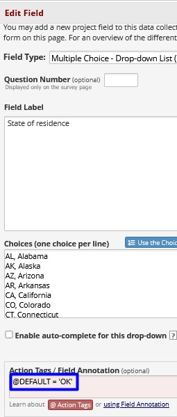{width=80%}

Notice that the value recorded in the data, OK, is the default value, not "Oklahoma," which is the label.
This action tag works only once, when the record is created.
If the data entry people or survey respondent needed to change it to Texas, they can use the drop-down menu to do so.
Their entry will not be overwritten with Oklahoma at a later time.
The default does not appear on the form you are creating in Online Designer.
It appears in a record, if you click the *Add/Edit Record* link on the left side of the screen and create a new record (see [Creating Records](../begin/create.md)).

### `@NONEOFTHEABOVE` {#sec-designint-action-common-none}

> Allows for the designation of a checkbox choice to be a 'none of the above' option, thus ensuring that no other choices are checked if that one choice is selected. This means that if that particular option is selected, it will alert the user that all other checked-off choices will be unchecked.
> And if the 'none of the above' option is already checked when the user checks off another choice, it will automatically uncheck the 'none of the above' option. This action tag makes it possible to have a 'none of the above' option without the risk of users mistakenly having other choices selected at the same time.
> The format must follow the pattern `@NONEOFTHEABOVE=??`, in which ?? is the coded value of the 'none of the above' checkbox choice - e.g., `@NONEOFTHEABOVE=98`. Alternatively, it is possible to set multiple options as a 'none of the above' option at the same time, in which the coded values must be comma delimited inside single or double quotes - e.g., `@NONEOFTHEABOVE='45,99'`. This is useful for certain situations, such as if you have a 'none of the above' option and also have a 'refuse to answer' option, thus allowing either of those to be the only option that can be selected at a time.
>
> * NOTE: This action tag can only be utilized by Checkbox fields.
>
> (Official definition from REDCap 17.6.2.)

Let's say we have a REDCap project that allows people signing up for a conference to indicate their preferences for lunch.
We create a checkbox multiple-choice item where the respondents can indicate all of the acceptable options for lunch.
One option is none of the above.

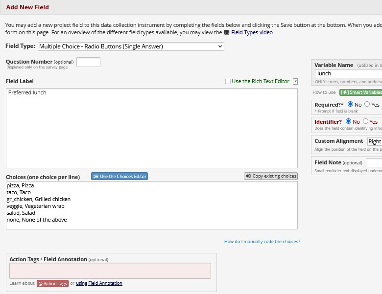{width=80%}

The `@NONEOFTHEABOVE` action tag will prevent a respondent who answers "None of the above" from checking any other lunch item.

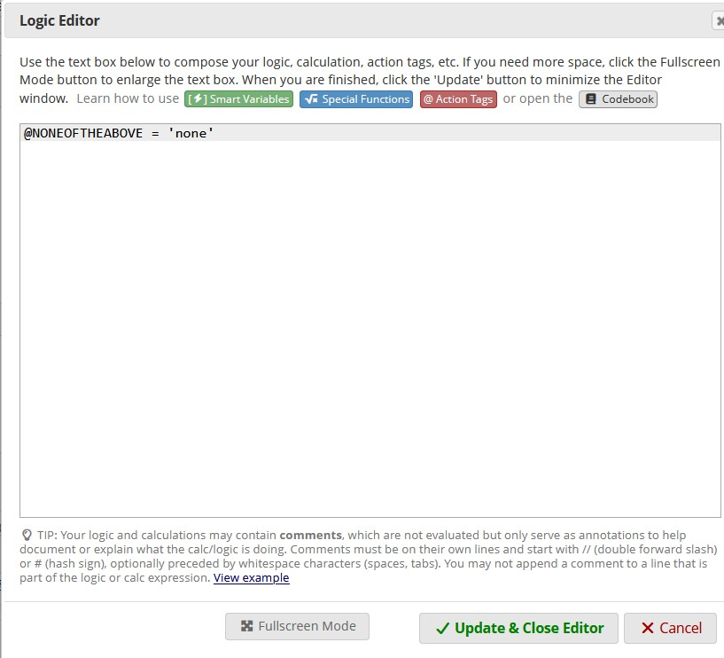{width=80%}

As we saw for the `@DEFAULT` action tag, the `@NONEOFTHEABOVE` action tag is followed by an equals sign, then the value recorded in the data, 'none' -- not the label "None of the above."
Generally speaking, when REDCap refers to character values like 'none,' the value is enclosed in single or double quotation marks.
When a numeric value is used to indicate "None of the above," then the number recorded in the data would follow the equals sign, without quotation marks.

### `@MAXCHECKED` {#sec-designint-action-common-maxchecked}

> Allows a checkbox field to have a maximum number of checkboxes that can be checked. If other checkbox options are clicked after the maximum has been reached, those choices will not be able to be checked. The format must be `@MAXCHECKED=#`, in which # is a positive integer. For example, `@MAXCHECKED=3` will allow a maximum of 3 checkbox choices to be checked.
>
> * NOTE: This action tag can only be utilized by Checkbox fields, and it does not get enforced during data imports.
>
> (Official definition from REDCap 17.6.2.)

Suppose we do not want everyone to check every option in our list of lunch choices in this checkbox field.
We can use the `@MAXCHECKED` action tag to limit everyone to their top 2 or 3 preferences.
We can change the Field label to "Indicate your top 3 preferences for lunch."
Then we click on the Action Tags/Field Annotation box to open the Logic Editor, where we list this action tag.

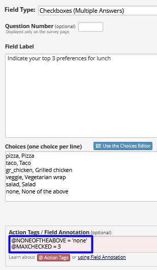{width=80%}

### `@HIDDEN` {#sec-designint-action-common-hidden}

> Hides the field on the survey page, the data entry form, and in the REDCap mobile app. Field will stay hidden even if branching logic attempts to make it visible.
> (Official definition from REDCap 17.6.2.)

Hiding an entire variable is useful in two scenarios:
retiring an existing variable and concealing a calculated variable.

#### Retire an existing variable {#sec-designint-action-common-hidden-retire}

As a production project evolves over time, some variables are added,
while some variables become irrelevant to future respondents.
It's encouraged to "remove" irrelevant variables so your instrument remains as stream-lined as possible,
for the sake of the respondents' time and the dataset's quality.

For most carefully-designed projects, these obsolete variables contain information that is still relevant
during later analysis.
In this case, use the `@HIDDEN` action tag to simply conceal the variable from the respondent, while retaining its data values in the database.

#### Conceal a calculated variable {#sec-designint-action-common-hidden-calculated}

Calculated variables/fields are described in @sec-designbas-variable-types-calculated.
Sometimes these derived values are useful to (to something like the branching logic or to an analyst),
but could confuse a respondent.
So use the `@HIDDEN` action tag to conceal it.

### `@HIDECHOICE` {#sec-designint-action-common-hidechoice}

> Hides one or more choices of a multiple choice field. This action tag is useful if you wish to retire a particular choice after utilizing it for a while in data collection, thus allowing you to hide the choice from that point afterward without orphaning any of the choice's data, which would happen if you simply deleted the choice. The format must follow the pattern `@HIDECHOICE='??'`, in which the coded values should be inside single or double quotes for the choice(s) you wish to hide. If more than one choice needs to be hidden, then provide all the coded values separated by commas.
> For example, to hide the choice `'Monday (1)'`, you would have `@HIDECHOICE='1'`, but if you wanted to additionally hide `'Tuesday (2)'`, you would have `@HIDECHOICE='1,2'`.
>
> * NOTE: If the hidden choice has already been selected for a given record, then the choice will not be hidden on the survey or form for that record/event.
> * NOTE: Hidden choices will still appear in reports and data exports.
> * NOTE: This action tag can only be utilized for the following field types: Checkbox, Radio, Drop-down, Yes-No, and True-False.
> * NOTE: This action tag works only in limited fashion with a matrix of fields, in which it will simply hide the checkbox/radio for a field in the matrix but still display the column for that choice in the matrix.
> * NOTE: This action tag supports piping into its argument.
>
> (Official definition from REDCap 17.6.2.)

Similar to [retiring an obsolete variable](actiontag.md#sec-designint-action-common-hidden-retire),
sometimes its best to remove an obsolete option from a multiple choice field.
Imagine a variable where a respondent selects their preferred training workshop:
they should no longer be able to select a workshop that already occurred.
The `@HIDECHOICE` action tag will conceal it from view,
while retaining its values in the underlying database,
so it can be analyzed later.

(Also see the [`@MAXCHECKED`](actiontag.md#sec-designint-action-common-maxchecked) action tag
to prevent too many respondents from selecting the same choice.)

## Less Common {#sec-designint-action-lesscommon}

### `@SETVALUE` {#sec-designint-action-lesscommon-setvalue}

> Sets a field's value to static text or dynamic/piped text whenever a data entry form or survey page is loaded, in which it will always overwrite an existing value of the field. The format must follow the pattern `@SETVALUE="????"`, in which the desired value should be inside single or double quotes. For text fields, you may pipe and concatenate values from other fields in the project - e.g., `@SETVALUE='Name: [first_name] [last_name], DOB: [dob]'`.
> For checkbox fields, simply separate multiple checkbox values with commas - e.g., `@SETVALUE='1,3,[other_field:value]'`.
>
> * NOTE: The piped value does *not* get applied during any data imports (via API or Data Import Tool) but only operates when viewing survey pages and data entry forms.
> * NOTE: A field with `@SETVALUE` will have its value updated ONLY when the page loads, which means that its value will not be updated in real-time if you modify other fields on the same page that are piped into the `@SETVALUE` tag.
> * NOTE: If being used on a date or datetime field, the date value inside the quotes must be in Y-M-D format - e.g., `@SETVALUE='2007-12-25'` - regardless of the field's set date format.
> * NOTE: The only difference between `@SETVALUE` and `@DEFAULT` is that `@DEFAUL`T is only applied when an instrument has no data yet, whereas `@SETVALU`E will always be applied on an instrument, meaning that `@SETVALUE` will ALWAYS overwrite the value if a field value already exists.
> * TIP: To pipe the value of one multiple choice field into another multiple choice field, make sure you append ':value' to the variable being piped - e.g., `@SETVALUE='[my_dropdown:value]'`. (In earlier versions of REDCap, the `@SETVALUE` action tag went by the name `@PREFILL`, which still works equivalently to `@SETVALUE` for backward compatibility purposes.)
>
> (Official definition from REDCap 17.6.2.)

Sometimes we want to help out the data entry people by setting the value of a field.
A project may have a form especially for interviewing the first child in a family.
We can use `@SETVALUE` to specify the child being interviewed.

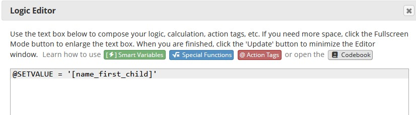{width=80%}

Let's say we have created a record for a family, and we have used Form 1 to enter some family information.
Now we want the first child's name to appear on the next form, which is being used to record data from interviewing Child 1.
We go into the family's record and click on the form for interviewing Child 1.
We will find Child 1's name, which was entered in the first form, automatically has been piped into this new form.

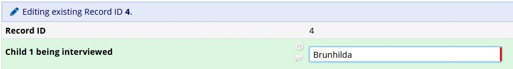{width=80%}

One caution: If you change the name that is piped into this field, it will revert to the piped-in value every time the record is opened. If you want to keep the data entry people from changing this value, you can use the next action tag.

### `@READONLY` {#sec-designint-action-lesscommon-readonly}

> Makes the field read-only (i.e., disabled) on the survey page, the data entry form, and in the REDCap mobile app so that its value cannot be changed.
>
> (Official definition from REDCap 17.6.2.)

Adding the `@READONLY` action tag on the next line after `@SETVALUE = '[variablename]'` will make the field read-only for the data entry people.

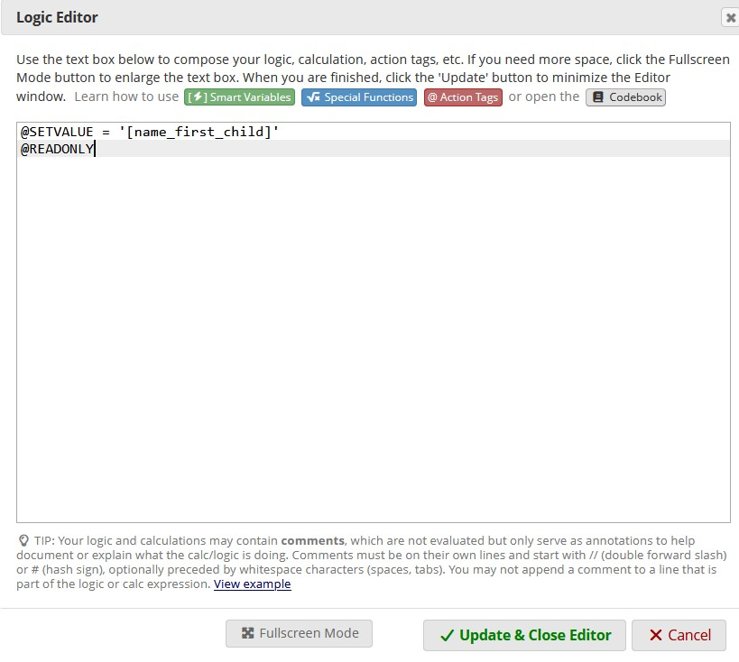{width=80%}

The child's name piped into the family's record will be in slightly gray font and cannot be edited.

### `@PLACEHOLDER` {#sec-designint-action-lesscommon-placeholder}

> Is used to specify a short hint that describes the expected value of a Text field or Notes field (e.g. a sample value or a short description of the expected format). The placeholder is displayed inside the field before a value is entered. The format must follow the pattern `@PLACEHOLDER='????'`, in which the text to be displayed should be inside single or double quotes.
>
> (Official definition from REDCap 17.6.2.)

The `@PLACEHOLDER` action tag will not record any data.
It is used as a hint to the person filling out the form.
We might have a multiple-choice item with "Other" as one of the options.
If someone chooses Other, we may add a follow-up item asking for details.
We can create gray text to appear in the box for their answer, giving a hint about what to put in the box.
The words we want to appear in gray will be typed inside quotation marks after `@PLACEHOLDER = ` as shown below.

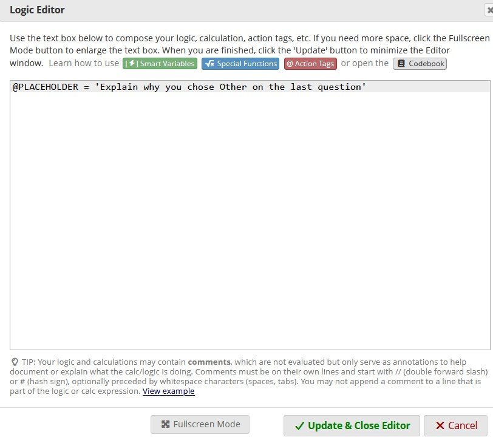{width=80%}

And here is what the result will look like. The words in this action tag are not saved as data.

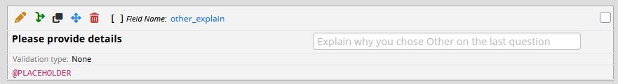{width=80%}

## Many Other Action Tags {#sec-designint-action-other}

If you have a specification that you would like to make in a form, there may be an action tag to help.
Just look through the available action tags by clicking on the red button inside the Logic Editor for action tags, clicking the link on the left side of the page in a REDCap project for *Help & FAQ*, or searching online.

::: {.callout-note appearance="simple"}

## Additional Chapter Details

This chapter was last edited in April 2026.
If you have suggested modifications or additions, please see [How to Contribute](../index.qmd#sec-welcome-contribute) on the book's welcome page.
:::
